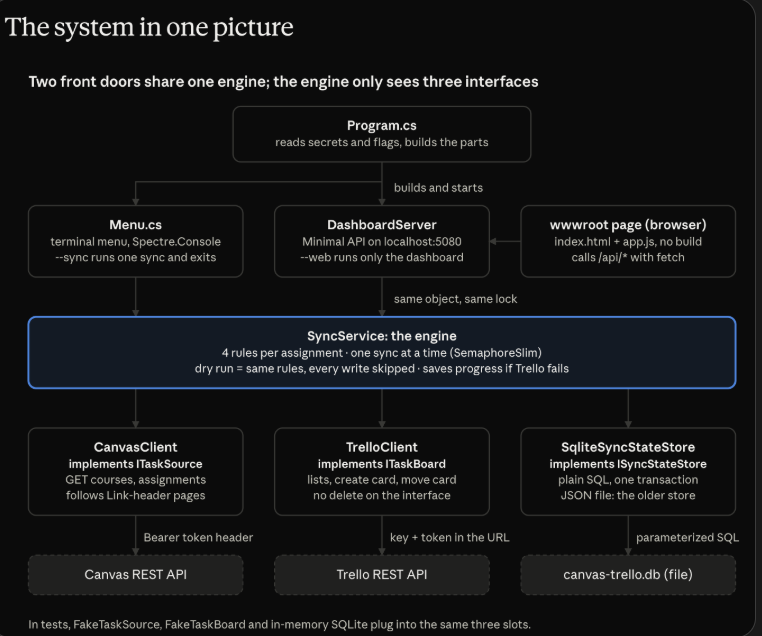

# canvasTrelloApiProject

A learning project about consuming third-party REST APIs in C#.

**CanvasTrelloSync** is a .NET 8 app that reads my assignments from [Canvas Network](https://learn.canvas.net) and keeps a [Trello](https://trello.com) board up to date:

- Every assignment I haven't submitted yet gets a Trello card in a list named after its course.
- When I submit an assignment on Canvas, the next sync moves its card to **Done**.
- The app remembers which cards it made, so it never creates the same card twice.

You can use it from a **terminal menu** or from a **web dashboard** at `http://localhost:5080`. Both use the same sync engine.



---

## For reviewers

**Try it in 30 seconds, with no accounts:**

```bash
cd CanvasTrelloSync
dotnet build
dotnet test ../CanvasTrelloSync.Tests    # 77 tests, no secrets, no internet
```

**Where to look first:**

| File | Why it's interesting |
|---|---|
| [`Services/SyncService.cs`](CanvasTrelloSync/Services/SyncService.cs) | The engine: the four sync rules, dry run, the lock, saving progress when Trello fails |
| [`Interfaces/`](CanvasTrelloSync/Interfaces) | `ITaskSource` and `ITaskBoard`: the seams that make the engine testable |
| [`Clients/CanvasClient.cs`](CanvasTrelloSync/Clients/CanvasClient.cs) | Bearer auth and `Link`-header pagination |
| [`Clients/TrelloClient.cs`](CanvasTrelloSync/Clients/TrelloClient.cs) | One `SendAsync` for auth and errors; the token never reaches an error message |
| [`Services/SqliteSyncStateStore.cs`](CanvasTrelloSync/Services/SqliteSyncStateStore.cs) | Plain parameterized SQL in one transaction, plus a one-time import from the old JSON file |
| [`CanvasTrelloSync.Tests/SyncServiceTests.cs`](CanvasTrelloSync.Tests/SyncServiceTests.cs) | The engine tested with `FakeTaskSource` and `FakeTaskBoard` |

**Key design decisions:**

- **Depend on interfaces, not APIs.** `SyncService` only knows `ITaskSource`, `ITaskBoard` and `ISyncStateStore`. Tests plug in fakes, and storage moved from a JSON file to SQLite without touching the engine, the menu or the dashboard.
- **Idempotent sync.** The app stores which card belongs to which assignment, so running a sync twice changes nothing the second time.
- **Safe by default.** `--dry-run` runs the exact same rules but skips every write. The `ITaskBoard` interface has no delete method, so the app can't remove cards.
- **No duplicates under concurrency.** The terminal and the dashboard share one `SyncService`, and a `SemaphoreSlim` lets only one sync (or reset) run at a time.
- **Partial failure is handled.** If Trello fails halfway, the cards already made are saved before the error is rethrown, so the next sync doesn't create them again.
- **Secrets stay secret.** Keys live in `dotnet user-secrets`, outside the repo. Logs and errors include the URL path only, never the token. `POST /api/sync` returns `403` when the request comes from another website, so a random page can't start a sync.
- **Fail soft on bad data.** Some Canvas Network courses block assignment access; those are skipped and reported, and the rest still sync.

**Trade-offs and what I'd do next:**

- The sync is **pull-based** (run by hand or from the dashboard). Canvas webhooks or a scheduled job would keep the board fresh without a click.
- State is a **local SQLite file** for one user. A multi-user version would need a server database and per-user tokens (OAuth instead of personal tokens).
- Canvas and Trello calls are **sequential**. Fetching course assignments in parallel, with retry and backoff for rate limits (HTTP 429), would make large syncs faster and sturdier.

---

## Contents

1. [For reviewers](#for-reviewers)
2. [Quick start](#quick-start)
3. [Setup in detail](#setup-in-detail)
4. [Ways to run it](#ways-to-run-it)
5. [How it works](#how-it-works)
6. [Testing](#testing)
7. [Project structure](#project-structure)

---

## Quick start

```bash
git clone https://github.com/gabriel-wargha/canvasTrelloApiProject.git
cd canvasTrelloApiProject/CanvasTrelloSync

# 1. Add your 5 secrets (see "Setup in detail" below)
dotnet user-secrets set "Canvas:BaseUrl" "https://learn.canvas.net"
dotnet user-secrets set "Canvas:Token"   "<your Canvas token>"
dotnet user-secrets set "Trello:ApiKey"  "<your Trello API key>"
dotnet user-secrets set "Trello:ApiToken" "<your Trello token>"
dotnet user-secrets set "Trello:BoardId" "<your board id>"

# 2. Run the tests (they need no secrets and no internet)
dotnet test ../CanvasTrelloSync.Tests

# 3. Start the app in safe preview mode
dotnet run -- --dry-run
```

> **Just reviewing the code?** You don't need any accounts. `dotnet build` and `dotnet test` work without secrets, because the tests use fake versions of Canvas and Trello.

---

## Setup in detail

### Requirements

- **.NET 8 SDK.** The version is pinned in [`global.json`](global.json) (`8.0.404`). Check with `dotnet --version`.
- A **Canvas Network** account with at least one active course (only needed to run the app).
- A **Trello** account with a board. You don't need to create any lists: the app makes one list per course, and a `Done` list, when the first card needs them.

### Secrets

The app reads 5 values from [`dotnet user-secrets`](https://learn.microsoft.com/aspnet/core/security/app-secrets). They are stored in your user profile, **outside the repo**, so they can never be committed by accident.

| Key | What it is | Where to get it |
|---|---|---|
| `Canvas:BaseUrl` | The Canvas site | `https://learn.canvas.net` |
| `Canvas:Token` | Your personal Canvas access token | Canvas → **Account → Settings → + New Access Token** |
| `Trello:ApiKey` | Your Trello API key | [trello.com/power-ups/admin](https://trello.com/power-ups/admin) → create a Power-Up → **API key** |
| `Trello:ApiToken` | Your Trello token | Same page, click the **Token** link next to the key and allow access |
| `Trello:BoardId` | The board to sync to | The code in the board URL: `trello.com/b/`**`AbC123xY`**`/my-board` |

Run the `dotnet user-secrets set ...` commands from inside `CanvasTrelloSync/`. If a secret is missing, the app stops right away with a red message that names the missing key (never its value).

---

## Ways to run it

Run these from inside `CanvasTrelloSync/`.

| Command | What happens |
|---|---|
| `dotnet run -- --dry-run` | Opens the menu. **Every sync is only a preview**: nothing changes on Trello and nothing is saved. Best for trying it out. |
| `dotnet run` | Opens the menu. Syncs are **real** and change your Trello board. |
| `dotnet run -- --sync --dry-run` | No menu. Runs one preview sync, prints what it would create or move, and exits. |
| `dotnet run -- --sync` | No menu. Runs one real sync and exits (exit code `1` if Canvas or Trello fails). |
| `dotnet run -- --web --dry-run` | No menu. Starts only the dashboard at `http://localhost:5080` until you press **Ctrl+C**. |

### The terminal menu

Use the arrow keys and Enter:

| Menu item | What it does |
|---|---|
| 📚 List my courses | Shows your active Canvas courses |
| 📝 List assignments | Shows every assignment with its todo/done status and its Trello list |
| 👀 Preview sync (dry run) | Shows what a sync *would* do, without doing it |
| 🔄 Sync to Trello | Runs the sync, with a progress bar and a result panel |
| 🌐 Open web dashboard | Starts the dashboard in the background and opens your browser |
| 🕒 Sync history | Shows the last syncs (time, terminal/web, created, moved, skipped) |
| 🧹 Reset sync history | Forgets every card and all history, after asking you to confirm |
| 🚪 Exit | Closes the app |

With `--dry-run`, the header shows a yellow **DRY RUN** badge and "Sync to Trello" becomes "Sync to Trello (preview only)".

### The web dashboard

The dashboard is a plain HTML/CSS/JS page with no build step. It has three tabs:

- **Overview**: progress per course, showing how many assignments are done.
- **Next**: one assignment per course to do next, with its points and links to Canvas and Trello.
- **Sync log**: the newest syncs first.

It also has a **Sync now** button and a light/dark mode switch, and it works on a phone-sized window.

It runs on a small JSON API, which you can also call with `curl`:

| Endpoint | Returns |
|---|---|
| `GET /api/summary` | Board name, last sync time, progress per course, and courses that couldn't be read |
| `GET /api/next` | One assignment per course to do next, with its points |
| `GET /api/history` | The sync history, newest first |
| `POST /api/sync` | Runs a sync and returns what was created, moved, and skipped |

Example:

```bash
dotnet run -- --web --dry-run      # in one terminal
curl http://localhost:5080/api/summary
curl -X POST http://localhost:5080/api/sync
```

---

## How it works

### The big picture

```
dotnet run [--dry-run] [--sync | --web]
   │
   ▼
Program.cs ─── loads secrets, reads flags, builds the parts below
   │
   ├── ITaskSource      ◄── CanvasClient           (reads Canvas)
   ├── ITaskBoard       ◄── TrelloClient           (reads and writes Trello)
   ├── ISyncStateStore  ◄── SqliteSyncStateStore   (canvas-trello.db)
   │                    ◄── JsonSyncStateStore     (sync-state.json, the older format)
   │
   ├── SyncService  ── the engine: one sync at a time
   │      ▲               ▲
   │      │               │
   ├── Menu (terminal)    DashboardServer (web, same process)
   │                           └── wwwroot/ index.html, app.js, styles.css
```

The important design idea is **interfaces**. `SyncService` only knows about `ITaskSource`, `ITaskBoard` and `ISyncStateStore`. It doesn't know it's talking to Canvas, Trello or SQLite. That means:

- the tests can plug in fakes instead of the real APIs, and
- the storage was switched from a JSON file to SQLite without changing `SyncService`, the menu or the dashboard.

### The sync rules

For each assignment, `SyncService` checks what Canvas says and what it remembers, and applies **one** of four rules:

| # | Situation | Action |
|---|---|---|
| 1 | It has no card yet | Create a card in its course's list (or straight in **Done** if it's already submitted) |
| 2 | Submitted, and its card is still open | Move the card to **Done** (create the Done list first if it's missing) |
| 3 | Still to do, but its card is in the old shared **Later** list | Move the card to its course's list (a one-time migration) |
| 4 | Anything else | Skip it |

An assignment counts as submitted when Canvas says its state is `submitted`, `graded` or `pending_review`. Course lists are named after the course, cut at a whole word if the name is long (`Services/CourseLists.cs`).

**Example.** On Monday you have 3 open assignments. The first sync creates 3 cards in their course lists. On Tuesday you submit one. The next sync moves that one card to Done and skips the other two. A third sync changes nothing.

### What the app remembers

The "sync state" is stored in `canvas-trello.db`, a SQLite database file in the `CanvasTrelloSync/` folder. It has two tables:

```sql
synced_cards (assignment_id, card_id, card_url, done, synced_at)   -- which card belongs to which assignment
sync_runs    (id, ran_at, trigger, created, moved, skipped)        -- the last 50 syncs
```

You can look inside with:

```bash
sqlite3 canvas-trello.db "SELECT * FROM synced_cards;"
```

Earlier versions stored the same data in `sync-state.json`. On the first real run, the app copies that file into the database once and renames it to `sync-state.imported.json`, so no card is created twice. Both files are in `.gitignore`.

### Talking to the APIs

- **Canvas:** the token is sent in the `Authorization: Bearer ...` header. Canvas returns results in pages, so `CanvasClient` keeps following the `rel="next"` link in the `Link` response header until there are no more pages. `include[]=submission` adds my own submission status to each assignment.
- **Trello:** the key and token go in the URL query string. Every call goes through one method (`SendAsync`), so authentication and error handling live in one place. Error messages only include the URL **path**, because the full URL contains the token.

---

## Testing

```bash
cd CanvasTrelloSync
dotnet test ../CanvasTrelloSync.Tests
```

All 77 tests run offline with no secrets:

- **`SyncServiceTests`**: every sync rule, dry run, history, the lock, and saving progress when Trello fails halfway, using `FakeTaskSource` and `FakeTaskBoard`.
- **`SqliteSyncStateStoreTests` / `JsonSyncStateStoreTests` / `SyncStateStoreTests`**: the stores, using in-memory SQLite and temp files, plus the JSON-to-SQLite import.
- **`DashboardServerTests`**: the JSON API endpoints and static file handling.
- **`CourseListsTests` / `NextActivityTests`**: list naming and the "what to do next" pick.

Tests are named `Method_Condition_ExpectedResult`, and bugs are fixed test-first: a failing test, then the fix.

---

## Project structure

```
canvasTrelloApiProject/
├── CanvasTrelloSync/              the app
│   ├── Program.cs                 entry point: secrets, flags, wiring
│   ├── Models/                    plain data classes (Course, Assignment, TrelloCard, SyncState, ...)
│   ├── Interfaces/                ITaskSource, ITaskBoard
│   ├── Clients/                   CanvasClient, TrelloClient (the HTTP code)
│   ├── Services/                  SyncService (the engine) and the two state stores
│   ├── UI/Menu.cs                 the terminal menu (Spectre.Console)
│   ├── Web/                       DashboardServer (ASP.NET Core Minimal API)
│   └── wwwroot/                   the dashboard page (index.html, app.js, styles.css)
├── CanvasTrelloSync.Tests/        xUnit tests
│   └── Fakes/                     FakeTaskSource, FakeTaskBoard
├── docs/PLAN.md                   the build plan, block by block
├── docs/images/                   the system design diagram
├── .claude/skills/api-reference/  notes on the Canvas and Trello APIs
├── AGENTS.md / CLAUDE.md          instructions for the AI assistant used on this project
└── global.json                    pins the .NET SDK version
```

### Tech stack

| What | Used for |
|---|---|
| C# 12 / .NET 8, nullable enabled | the whole app |
| `HttpClient` + `System.Text.Json` | calling the Canvas and Trello REST APIs |
| ASP.NET Core Minimal API | the dashboard's JSON API, hosted inside the same app |
| `Microsoft.Data.Sqlite` | the database, with plain SQL and no ORM |
| `Spectre.Console` | the colorful terminal menu, tables and progress bar |
| `dotnet user-secrets` | keeping keys and tokens out of the repo |
| xUnit | tests |

